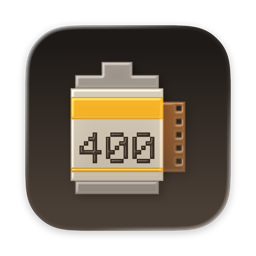
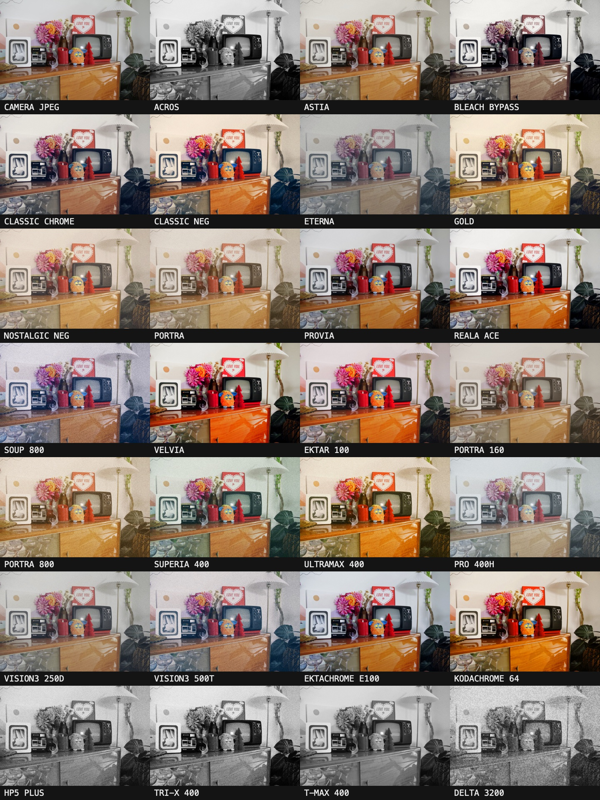
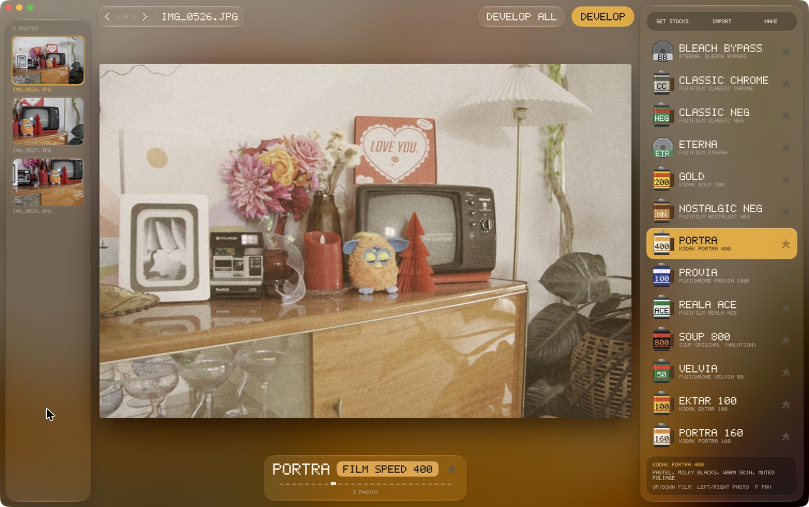
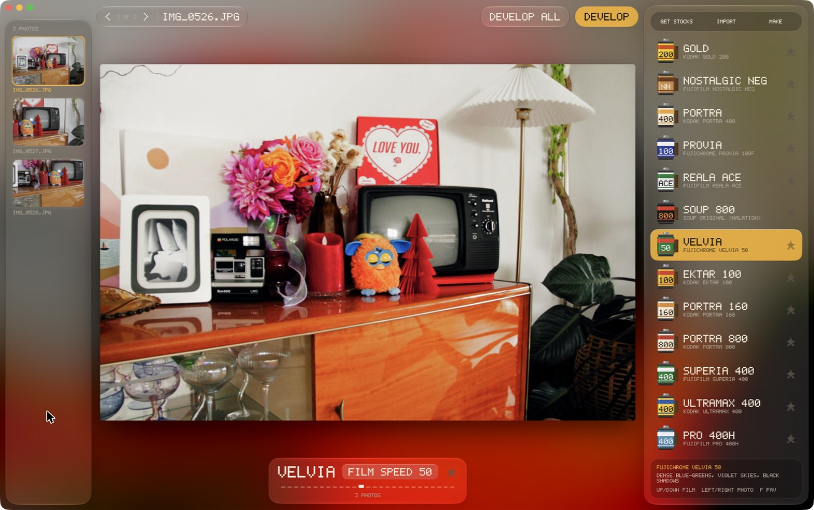
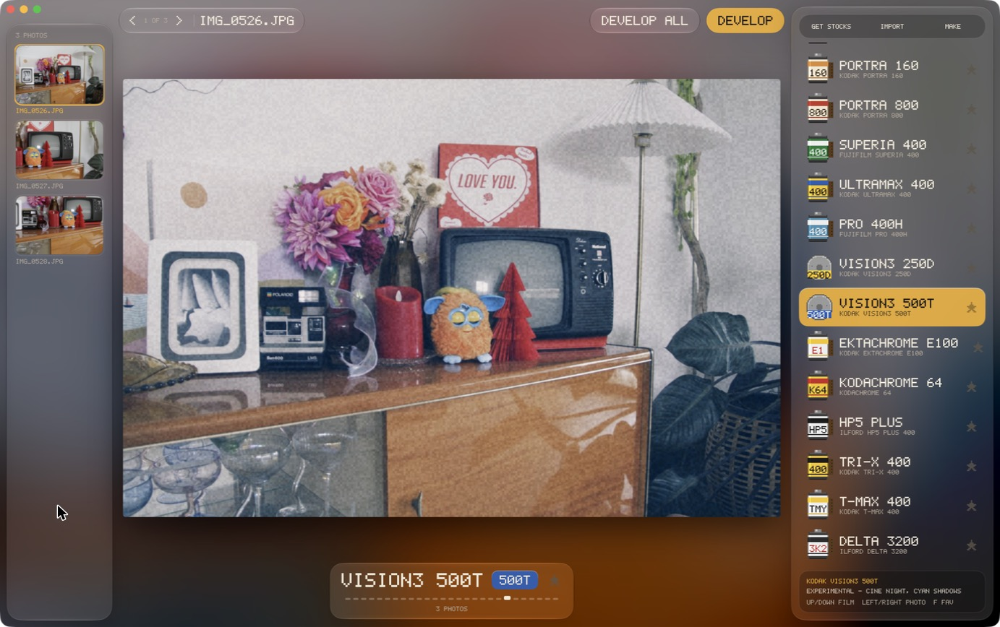

<p align="center"></p>

# SoupDesk

Film looks for your Mac. SoupDesk runs your photos through 27 film stocks from
[Soup Engine](https://github.com/jiijii0/soup-engine): drop in a folder of raws or JPEGs, pick a film,
press Return, and a developed JPEG lands next to your originals.

It is the desktop sibling of [Souper7D](https://github.com/thebakers-club/souper7d), which does the same
thing inside an original Canon EOS 7D with the same engine and stocks.

**[Download SoupDesk.zip](https://github.com/thebakers-club/SoupDesk/releases/latest/download/SoupDesk.zip)**:
signed and notarized, for Apple silicon and Intel Macs on macOS 12 or later.



<p>



</p>

The film names are shorthand for the stocks the looks are based on, not exact copies. All trademarks
belong to their owners. Stocks marked EXPERIMENTAL are new in Souper7D and still being tuned.

## What you need

- A Mac on macOS 12 Monterey or later, Apple silicon or Intel (a 2015 MacBook Pro works). On macOS 26
  and later the window and icon are Liquid Glass; earlier versions get the standard blur. Older Intel
  Macs are slower to switch films and develop.
- Photos as camera raw (CR2, CR3, NEF, ARW, RAF, DNG, ORF, RW2, PEF, SRW, NRW), JPEG, HEIC or TIFF.
  Raws are decoded by macOS, so any camera your Mac's Photos app can open works. On an older macOS,
  raws from cameras newer than that release may not open.

## Install

1. [Download SoupDesk.zip](https://github.com/thebakers-club/SoupDesk/releases/latest/download/SoupDesk.zip)
   and unzip it.
2. Drag **SoupDesk.app** to Applications and open it. It's signed with a Developer ID and notarized by
   Apple, so it opens without a warning.

## Use

Drag photos or a folder onto the window, or press **Cmd O**.

| Key | What it does |
| --- | --- |
| **Up / Down** | Change film |
| **Left / Right** | Previous / next photo |
| **F** or the star | Favourite the film (favourites come first) |
| **Return** or **Cmd E** | Develop this photo |
| **Shift Cmd E** | Develop every photo, each with the film you picked for it |

Each photo remembers its own film, and a new photo starts on the last one you used. The preview is graded
live; developing renders the full-size file.

Developed files go to `<photo folder>/Soup/<name>_<film>.jpg` at full resolution, quality 92, with the original EXIF
kept and `SoupDesk - <film>` in the Software tag. Nothing is ever overwritten: a second develop gets a
`-2`, `-3`… suffix, and your originals are never touched.

### More stocks

- **Get stocks** pulls any new official stocks from upstream Soup Engine.
- **Import** (or drop `.fs` files on the window) adds your own.
- **Make** opens the [Soup Stocks web editor](https://jiijii0.github.io/soup-stocks/) to build one.

Your stocks live in `~/Library/Application Support/SoupDesk/Stocks`. A stock whose name already exists is
skipped.

## The stocks

Colour: Astia, Classic Chrome, Classic Neg, Ektachrome E100\*, Ektar 100\*, Eterna, Gold, Kodachrome 64\*,
Nostalgic Neg, Portra, Portra 160\*, Portra 800\*, Pro 400H\*, Provia, Reala Ace, Soup 800, Superia 400\*,
Ultramax 400\*, Velvia, Vision3 250D\*, Vision3 500T\*, Bleach Bypass.
Black and white: Acros, Delta 3200\*, HP5 Plus\*, T-MAX 400\*, Tri-X 400\*.

\* new in Souper7D (EXPERIMENTAL). The rest come from Soup Engine.

Stocks are plain-text `.fs` files: curves, per-hue saturation, split toning, grain and halation. A stock is
a complete look; there are no sliders to tune afterwards.

## Building

You need Xcode 26 or later (for the Liquid Glass APIs; the app still targets macOS 12, as a universal Apple silicon + Intel build).

```bash
./build_app.sh          # build/SoupDesk.app, signed with your Apple Development identity
./build_app.sh dist     # Developer ID, notarized and stapled, plus build/SoupDesk.zip
```

`SIGN_IDENTITY=` overrides the signing identity. `dist` needs a Developer ID Application certificate
(Xcode → Settings → Accounts → Manage Certificates) and a notarytool keychain profile, by default
`soupdesk-notary`:

```bash
xcrun notarytool store-credentials soupdesk-notary --apple-id <you> --team-id <your team id>
```

Layout:

- `Sources/SoupEngine/`: Soup Engine C, copied unmodified from Souper7D's `src/engine`, plus `soup_bridge.c`.
- `Sources/SoupKit/`: decoding (ImageIO / CIRAWFilter), grading and developing.
- `Sources/SoupDesk/`: the SwiftUI app. `Resources/Stocks/`: the 27 `.fs` files and `INDEX.TXT`.
- `Sources/soupcheck/`: verification CLI.
- `Design/SoupDesk.icon`: the Icon Composer icon, traced from the Portra sprite by `tools/make_icon.py`.

### Checks

```bash
swift build -c release
.build/release/soupcheck photo.jpg Resources/Stocks/gold.fs
```

compares the app's grading against the camera-shaped engine path (engine decoder rows straight into the
look); the wrapper must differ by 0. `soupcheck --develop photo.jpg stock.fs` runs the app's develop path
on one file. The contact sheet above is made with it and `tools/contact_sheet.swift`.

## Credits and licence

Soup Engine is by [jiijii0](https://github.com/jiijii0/soup-engine): the engine, its decoder, the stock
format and the original 13 stocks are theirs. SoupDesk takes the engine and stocks from
[Souper7D](https://github.com/thebakers-club/souper7d), the Canon 7D port, which adds 14 stocks and the
speed work; this repo adds the Mac app.

GPL v2, see [LICENSE](LICENSE).
